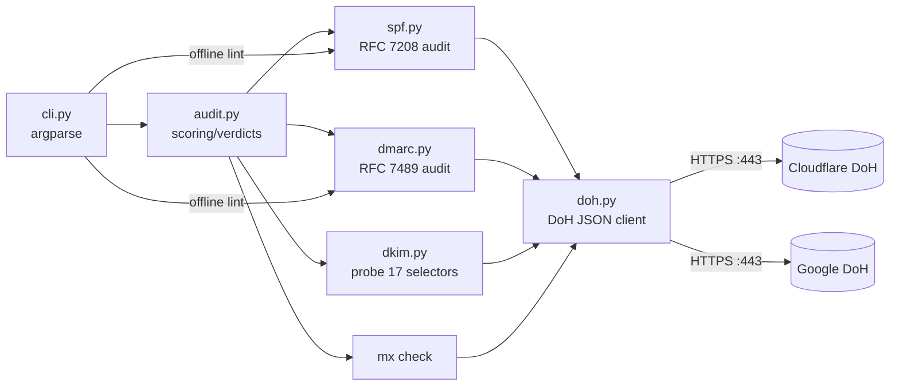

# spoofscope

> **Is your domain spoofable?** One zero-dependency command audits SPF, DMARC, DKIM and MX and tells you exactly how easy it would be for a stranger to send email that looks like it comes from you.

   

spoofscope resolves your DNS over **HTTPS** (works from CI, sandboxes, and laptops behind corporate firewalls - nothing to install beyond Python itself), grades the domain from **A+ to F**, prints the **exact fix for every finding**, and exits non-zero when the grade drops so you can gate deploys and DNS changes in CI.

```
$ spoofscope yourdomain.com
email spoofing exposure audit
target: yourdomain.com
verdict: PARTIAL - some enforcement exists, but gaps let forged mail through to spam or inboxes

  SPF    CRITICAL: [spf-open] `+all` authorizes the entire internet to send mail as yourdomain.com
         fix: replace `+all` with a list of your real senders, then `-all`
  ...
score: 3/100  grade: F
```

---

## Why this exists

Email spoofing is still the #1 way impersonation reaches inboxes, and 2026 turned basic email authentication from a nicety into table stakes:

- **Google and Yahoo's bulk-sender rules** made SPF + DKIM + DMARC mandatory for anyone sending bulk mail; other receivers followed.
- Industry data shows **more than a third of domains that publish DMARC never reach enforcement** - they sit on `p=none` forever, watching reports while forged mail keeps landing.
- Analyst coverage in 2026 describes monitoring-only DMARC as *"functionally a surrender to sophisticated spoofing."*
- Most tooling is a **paid SaaS dashboard**. The gap between "I just changed a DNS record" and "verified it actually protects the domain" had no good zero-install answer.

spoofscope is that answer: a defensive audit tool for **your own domains** - pre-deploy linting, post-deploy verification, and continuous CI gating.

## What it checks

| Area | Finding codes | Severity |
|------|---------------|----------|
| **SPF** (RFC 7208) | `spf-missing` | CRITICAL |
| | `spf-open` (`+all`), `spf-ip4-anywhere`, `spf-ip6-anywhere` | CRITICAL |
| | `spf-neutral` (`?all`), `spf-implicit-all` (no `all`), `spf-duplicate`, `spf-lookup-overflow` (>10 DNS lookups recurred through `include:`), `spf-invalid-term` | HIGH |
| | `spf-softfail` (`~all`) | WARN |
| | `spf-ptr-deprecated` | INFO |
| **DMARC** (RFC 7489) | `dmarc-missing`, `dmarc-no-policy` (record ignored by receivers) | CRITICAL |
| | `dmarc-monitor-only` (`p=none`), `dmarc-pct-partial` (only N% of mail protected), `dmarc-duplicate`, `dmarc-invalid-policy` | HIGH |
| | `dmarc-no-rua` (no reports - you're blind), duplicate/unknown/malformed tags, bad `pct` format | WARN |
| | `dmarc-quarantine`, `dmarc-sp-inherit`, `dmarc-relaxed-alignment` | INFO |
| **DKIM** (RFC 6376) | `dkim-trivial-key` (<1024-bit RSA - factorable) | CRITICAL |
| | `dkim-weak-key` (<2048-bit), | HIGH |
| | `dkim-not-found` (probes 17 common selectors) | WARN |
| | `dkim-key-revoked` (empty `p=`, consolidated when a wildcard `*._domainkey` covers every selector) | INFO |
| **MX** | `mx-none` | INFO |

Scoring: start at 100, subtract 35 / **CRITICAL**, 20 / **HIGH**, 8 / **WARN**, 0 / **INFO**. Grades: **A+** ≥95, **A** ≥85, **B** ≥70, **C** ≥55, **D** ≥40, **F** below.

Headline verdicts:

| Verdict | Meaning |
|---------|---------|
| **ENFORCED** | `p=reject`/`p=quarantine` + hard SPF (`-all`) + no criticals - receivers can reject forged mail on sight |
| **PARTIAL** | policy exists but gaps (softfail SPF, `quarantine`, missing DKIM visibility) let some forged mail through to spam/inboxes |
| **SPOOFABLE** | no DMARC, `p=none`, or fail-open SPF - receivers have no working policy to reject forged mail |

## Installation

spoofscope needs **Python 3.9+ and nothing else** - no pip dependencies, no DNS client libraries, no root.

```bash
# from a checkout
pip install .

# or run straight from the source tree
PYTHONPATH=src python3 -m spoofscope.cli example.com

# verify
spoofscope --version
```

## Usage guide

```text
spoofscope [domains...] [options]

domains               one or more domains to audit
--json                machine-readable output (one JSON document per domain)
--min-grade B         exit 1 if any domain grades below this (default B)
--lint-spf RECORD     offline: lint a candidate SPF record before you deploy it
--lint-dmarc RECORD   offline: lint a candidate DMARC record before you deploy it
--selectors a,b,c     extra DKIM selectors to probe
--no-dkim             skip DKIM probing (fewer DNS queries)
--no-mx               skip the MX existence check
--resolver cloudflare 'cloudflare', 'google', or any DoH endpoint URL
--timeout 10          DoH timeout in seconds
--version             print version and exit
```

### Examples

**Audit a hardened domain - example.com (real output):**

```
$ spoofscope example.com
email spoofing exposure audit
target: example.com
verdict: ENFORCED - SPF + DMARC combine to make spoofed mail rejectable by receivers

  DMARC  WARN:     [dmarc-no-rua] no rua= aggregate reporting address - you are blind: DMARC success cannot be verified
         fix: add `rua=mailto:dmarc-reports@yourdomain` so receivers tell you what passes
  DKIM   INFO:     [dkim-key-revoked] 17 common selectors publish empty (revoked) keys - likely a wildcard `*._domainkey` record blocking key-namespace abuse
         fix: expected on hardened reserved domains; verify your real signing selector is active

score: 92/100  grade: A
spf=-all   dmarc=p=reject   dkim selectors=amazonses,default,dkim,google,k1,k2,mail,mailgun,mandrill,protonmail,s1,s2,selector1,selector2,sendgrid,smtp,zoho
dns queries: 3
```

(A nice touch from the real world: the reserved example.com is deliberately hardened by IANA - `v=spf1 -all`, `p=reject`, and a wildcard of revoked DKIM keys. The tool recognizes the wildcard pattern instead of flooding you with 17 identical findings.)

**Audit a domain with nothing published - reserved `.example` domain (real output):**

```
$ spoofscope spoof-demo-not-configured.example
verdict: SPOOFABLE - receivers have no working policy to reject forged mail as this domain

  SPF    CRITICAL: [spf-missing] no SPF record published for spoof-demo-not-configured.example
         fix: publish `v=spf1 <your senders> -all` as a TXT record on spoof-demo-not-configured.example (RFC 7208)
  DMARC  CRITICAL: [dmarc-missing] no DMARC record at _dmarc.<domain> - receivers have no policy for forged mail
         fix: publish `v=DMARC1; p=quarantine; rua=mailto:you@domain` and graduate to p=reject
  DKIM   WARN:     [dkim-not-found] no DKIM public key found on 17 common selectors ...
         fix: publish TXT `<selector>._domainkey.spoof-demo-not-configured.example` containing `v=DKIM1; k=rsa; p=<key>`
  MX     INFO:     [mx-none] no MX record - the domain cannot receive mail (bounce-based abuse less relevant)

score: 22/100  grade: F
spf=none   dmarc=-   dkim selectors=none found
```

**Lint record strings before deploying them - no DNS, fully offline:**

```
$ spoofscope --lint-spf "v=spf1 include:a.com include:b.com +all" --lint-dmarc "v=DMARC1; p=none; pct=10"
verdict: SPOOFABLE - receivers have no working policy to reject forged mail as this domain

  SPF    CRITICAL: [spf-open] `+all` authorizes the entire internet to send mail as (lint)
  DMARC  HIGH:     [dmarc-monitor-only] p=none - monitoring only: receivers will deliver forged mail anyway ...
  DMARC  HIGH:     [dmarc-pct-partial] pct=10 - policy is applied to only 10% of mail; the remaining 90% is unprotected

score: 17/100  grade: F
```

**CI gate - fail the pipeline when a domain silently loses enforcement:**

```yaml
# .github/workflows/email-auth.yml
name: email-auth
on:
  schedule: [{cron: "0 6 * * *"}]
  push: {paths: ["dns/**"]}
jobs:
  audit:
    runs-on: ubuntu-latest
    steps:
      - uses: actions/checkout@v4
      - uses: actions/setup-python@v5
        with: {python-version: "3.12"}
      - run: pip install .
      - run: spoofscope mail.example.com --min-grade A
```

**JSON output for SOAR / inventory pipelines:**

```bash
spoofscope --json mail.example.com billing.example.com | jq -c '.[]? // .'
```

Each document contains `domain`, `verdict`, `score`, `grade`, `dmarc_policy`, `spf_all`, `dkim_selectors`, `queries` and the full `findings` array.

## Architecture



```text
                 +--------------------+
   domains ----->|      cli.py        |
   --lint-* ---> | argparse / gates   |
                 +---+------------+---+
                     |            |
              online |            | offline lint mode
                     v            v
                 +---+----+   +---+---+
                 |audit.py|   |spf.py |
                 | score  |   |dmarc.py|
                 +--+--+--+   +-------+
                    |  |  |
        +-----------+  |  +----------+
        v              v             v
   +----+---+   +------+------+  +---+----+
   | spf.py |   |  dmarc.py    |  |dkim.py |
   +----+---+   +------+------+  +---+----+
        |              |             |
        +------+  +----+-------+     |
               v  v            v     v
              +----------------------+
              |  doh.py  (stdlib)    |
              |  JSON via HTTPS:443  |
              +----------+-----------+
                         |  cached per-domain
        Cloudflare-dns.com  or  dns.google
```

Everything is pure standard library: `urllib.request` for DoH, `argparse` for the CLI, `base64` for key math, `unittest` for the suite.

### How resolution works

1. The domain's TXT records are fetched and split into logical SPF records (multi-string TXT records are re-joined per RFC 7208).
2. `_dmarc.<domain>` TXT is fetched and tags are parsed per RFC 7489 (duplicate/unknown/malformed tags become findings, since receivers parse conservatively).
3. DKIM: because DKIM has no discovery mechanism, spoofscope probes `<selector>._domainkey.<domain>` for 17 common selectors and reports what - if anything - is published, flagging weak (<2048-bit) or empty (revoked) keys. Wildcard patterns are consolidated into a single note.
4. SPF lookup counting follows RFC 7208 §4.6.4: `include`, `a`, `mx`, `ptr`, `exists` and `redirect` each cost a lookup, and `include:` targets are followed **recursively** (bounded) so nested SPF sprawl is counted, not just your own record.

## Security use cases

1. **Post-change verification** - you moved your DNS provider or renamed a selector; confirm enforcement still holds before users notice.
2. **DMARC graduation guard** - moving `p=none → quarantine → reject`? Run `--min-grade A` and let the pipeline tell you when your domain actually earns the grade.
3. **Pre-deploy linting** - `--lint-spf` / `--lint-dmarc` catch `+all`, `pct` typos and lookup overflow *before* the record hits production DNS.
4. **M&A and vendor onboarding** - inventory every domain you're now responsible for in one command, JSON out to your asset tracker.
5. **MSSP / MSP packages** - run across all client domains as a scheduled job; a grade slide emails you instead of a client.
6. **Abandoned-domain risk** - domains you own but no longer send from should still publish `v=spf1 -all` + `p=reject`; find the ones that don't.
7. **Security training evidence** - show stakeholders the before/after scores of a domain-hardening project in one command's output.

## Exit codes

| Code | Meaning |
|------|---------|
| 0 | every audited domain met `--min-grade` |
| 1 | at least one domain graded below `--min-grade` |
| 2 | usage error |
| 64 | DNS-over-HTTPS unreachable - your network is blocking the resolver |

## ⚖️ Legal & ethical use

spoofscope is a **defensive, read-only** tool: it queries only public DNS records for domains you point it at, never sends email, and never modifies anything.

- **Only audit domains you own or are explicitly authorized to assess.** Looking up someone's public SPF is not illegal, but parking automated scans against third-party brands you have no relationship with is out of scope for this project and its intended use.
- spoofing *for* people is out of scope: there is no send-mail functionality in this codebase, and there never will be.
- This tool exists to **close** the spoofing exposure that DMARC was designed to close - blue team / auditing / deliverability work only.

## Honesty / limitations

- **It reads DNS, not inboxes.** A perfect grade means receivers have the records they need to reject forgery - not that every receiver applies them identically.
- **DKIM probing is heuristic.** DKIM has no discovery mechanism, so "not found on 17 common selectors" means exactly that; a private selector can hide a working key. Pass `--selectors` to probe yours.
- **Organizational-domain nuance.** DMARC alignment is evaluated against the organizational domain per PSL rules; spoofscope audits the domain name you give it, per-record. It does not fetch the Public Suffix List.
- **RF exercises are not tested.** This checks records, alignment policy strings and key hygiene - and does not attempt to connect to any mail server or crack any key.
- Cloudflare vs Google DoH can briefly serve different caches; if a finding looks stale, re-run or switch `--resolver`.
- 86 unit tests cover audit logic against fixture DNS zones and live smoke runs were validated against real reserved domains; network behavior is mocked in the suite on purpose so CI is hermetic.

## Running the tests

```bash
PYTHONPATH=src:tests python3 -m unittest discover -s tests -v
# Ran 86 tests ... OK
```

## License

MIT - see [LICENSE](LICENSE).
